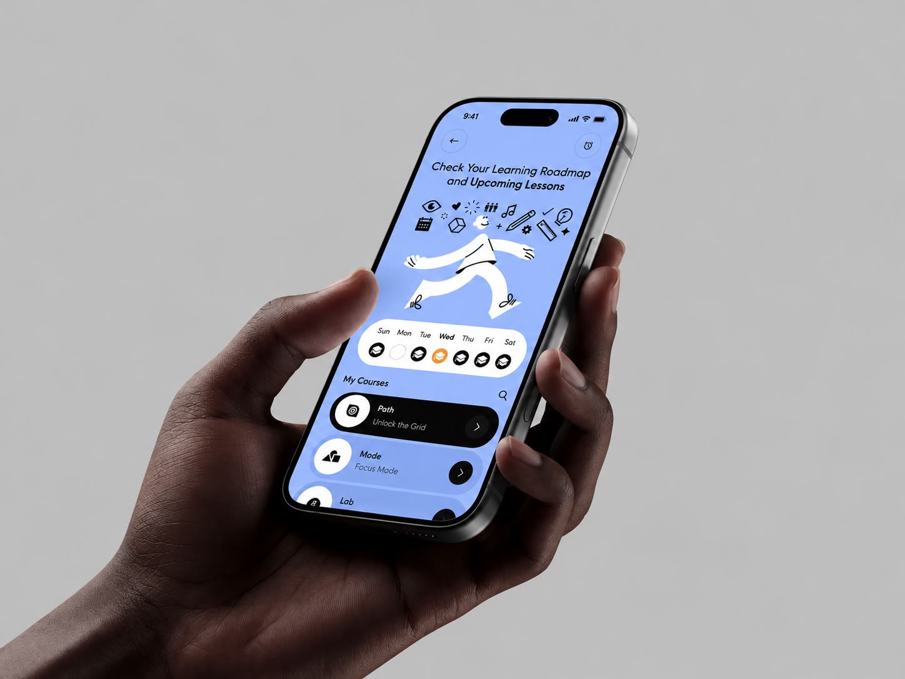

Placeholder text. Search for "website cost" and you'll find everything from a few euros a month with a site builder to several thousand with an agency. To make sense of it, separate what you pay once from what you pay every month.

## What you pay once

Building the site covers the work done before launch. What's included varies a lot, so read the quote carefully.

- **Planning**: understanding your business, your customers and what the site should help them do.
- **Text**: often missing from quotes, yet it takes the most time.
- **Design**: a homepage mockup, approved before the rest is built.
- **Build and launch**: the complete site, tested on phones and computers.

> A clear quote says what's included, what isn't, and what an extra page costs.

## What you pay every month

A live site needs hosting, a domain renewed every year, security updates and often a professional email address. Some providers bundle this into a plan, others bill it separately.

### Hidden costs to watch for

Small changes billed by the hour, a domain registered in the provider's name, or fees to get your site back if you leave. Ask before you sign.

## Questions to ask before signing

1. Who writes the text, and is it included?
2. How many rounds of corrections are planned?
3. Will the domain be in my name?
4. What happens if I want to switch providers?

## In short

The right price is one you fully understand before signing. Compare quotes that detail the same steps, and be wary of very low prices that say nothing about text or follow-up.
